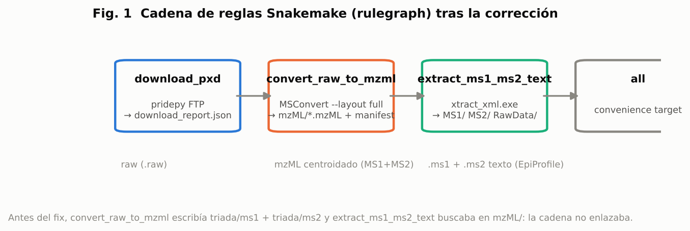
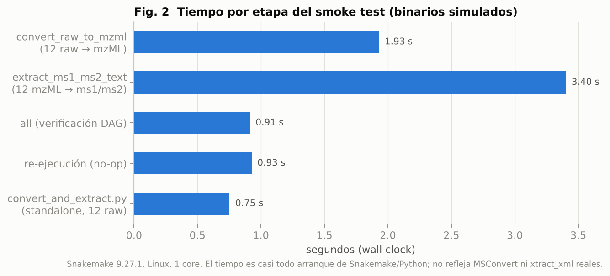
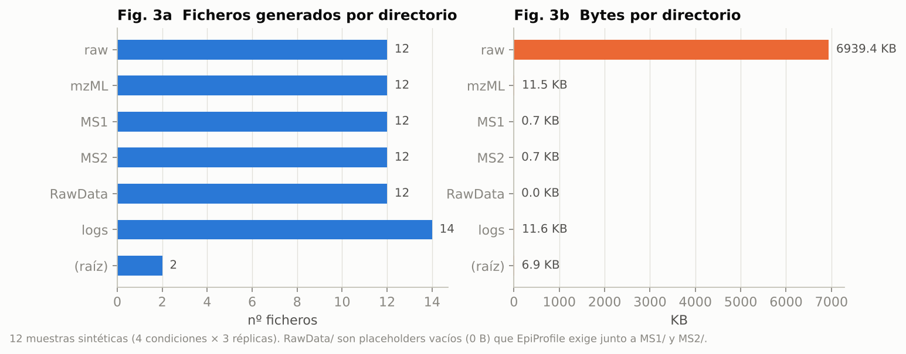
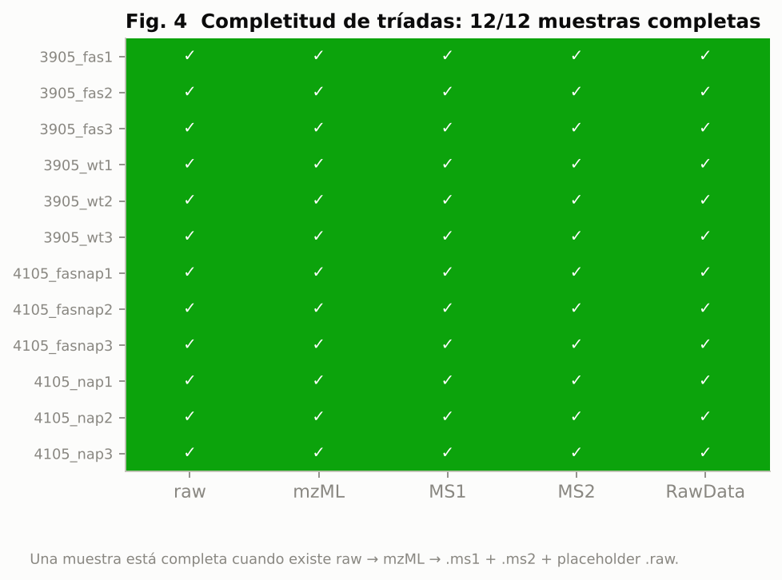
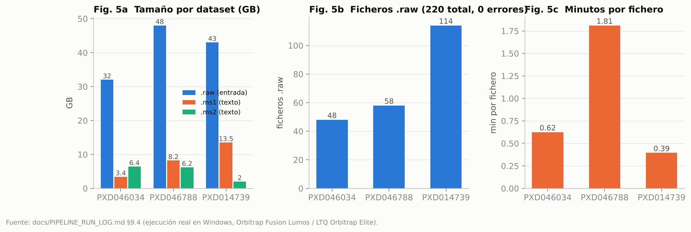
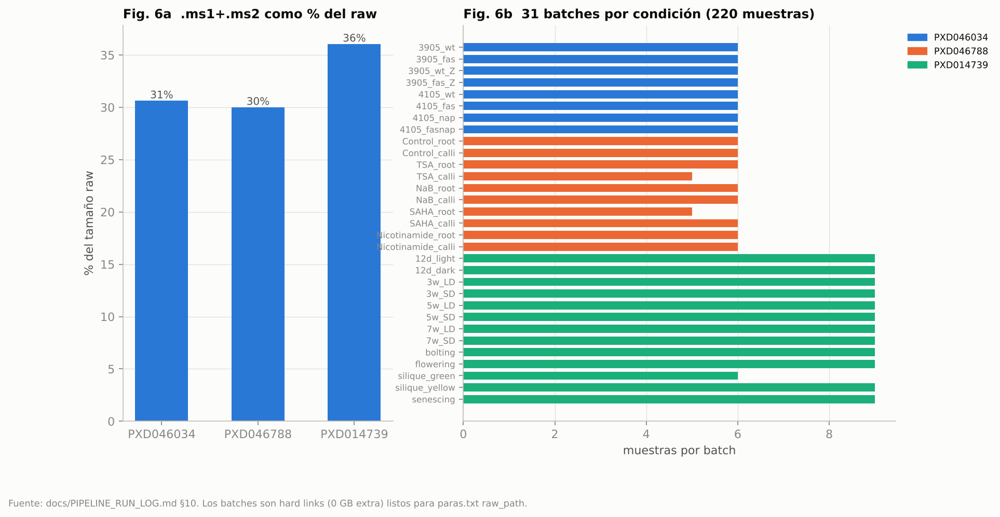

# Informe del smoke test y análisis del pipeline

Fecha: 2026-10-30. Entorno: Linux, Python 3.12, Snakemake 9.27.1, 1 core.
MSConvert y xtract_xml.exe son binarios de Windows, así que se usaron los
sustitutos de `tests/fakebin/` (misma interfaz de línea de comandos, salida
sintética). Lo que se valida aquí es el **cableado del pipeline**, no la
conversión espectral real. Esa quedó validada con 220 ficheros reales en
Windows (ver `PIPELINE_RUN_LOG.md`, §9.4).

## 1. Qué se ejecutó

| Prueba | Entrada | Resultado |
|---|---|---|
| Snakemake `download_report → convert_raw_to_mzml → extract_ms1_ms2_text → all` | 12 `.raw` sintéticos (4 condiciones × 3 réplicas) | 12/12 mzML, 12/12 `.ms1`, 12/12 `.ms2`, 12 placeholders `.raw` |
| Re-ejecución de Snakemake | mismo directorio | "Nothing to be done" (idempotente) |
| `convert_and_extract.py` standalone | 12 `.raw`, rutas de herramientas **relativas** | 12/12 tríadas completas, `mzML/` borrado |
| `convert_and_extract.py` con xtract que falla | 1 `.raw` | `mzML/` conservado para reintento |
| `pxd_triada_pipeline.py --layout triada` (legacy) | 3 `.raw` | `triada/ms1`, `triada/ms2`, `triada/raw_empty` como antes |

`bash tests/run_smoke_test.sh` reproduce todo en unos 10 s.

## 2. Figuras

### Fig. 1. Cadena de reglas tras la corrección


Antes del arreglo `convert_raw_to_mzml` producía el layout partido
`triada/ms1` + `triada/ms2`, y `extract_ms1_ms2_text` buscaba mzML completos en
`mzML/`. El DAG era válido sintácticamente pero la segunda regla no encontraba
ficheros. Ahora la conversión usa `--layout full` y la cadena enlaza.

### Fig. 2. Tiempo por etapa


| Etapa | s |
|---|---|
| convert_raw_to_mzml (12 raw) | 1.93 |
| extract_ms1_ms2_text (12 mzML) | 3.40 |
| all (sólo verificación) | 0.91 |
| re-ejecución no-op | 0.93 |
| convert_and_extract.py (12 raw) | 0.75 |

El coste es arranque de Snakemake y Python (≈0.9 s fijos por invocación), no
procesamiento. Con los binarios reales el tiempo lo domina MSConvert
(0.4 a 1.8 min por fichero, Fig. 5c).

### Fig. 3. Inventario de salida


Cada muestra produce exactamente un fichero en `mzML/`, `MS1/`, `MS2/` y
`RawData/`, más un log de MSConvert por fichero y dos logs agregados.
`RawData/` son ficheros de 0 bytes: EpiProfile exige un `.raw` con el mismo
nombre junto a los `.ms1`/`.ms2`, pero no lo lee.

### Fig. 4. Completitud de tríadas


Esta es la comprobación que importa para EpiProfile: para cada muestra deben
existir `.ms1`, `.ms2` y el placeholder `.raw`. 12/12 completas.

### Fig. 5. Ejecuciones reales documentadas (PIPELINE_RUN_LOG.md)


| PXD | ficheros | raw GB | ms1 GB | ms2 GB | min | min/fichero |
|---|---|---|---|---|---|---|
| PXD046034 | 48 | 32 | 3.4 | 6.4 | 30 | 0.62 |
| PXD046788 | 58 | 48 | 8.2 | 6.2 | 105 | 1.81 |
| PXD014739 | 114 | 43 | 13.5 | 2.0 | 45 | 0.39 |

PXD046788 es tres veces más caro por fichero que PXD014739: ficheros Lumos más
grandes (0.83 GB/raw frente a 0.38) y, en la primera pasada, un cuelgue de
MSConvert en `TSA_root1.raw`. PXD014739 (Orbitrap Elite) tiene MS2 mucho más
ligeros: 2 GB de texto para 114 ficheros.

### Fig. 6. Reducción de tamaño y batches


Los `.ms1`+`.ms2` ocupan un 30 a 36 % del raw. Los 31 batches por condición
(hard links, 0 GB extra) son los `raw_path` candidatos para `paras.txt`.

## 3. Bugs encontrados y corregidos en esta sesión

1. **Cadena Snakemake rota** (layout triada vs `mzML/`). Corregido con
   `--layout full` en `pxd_triada_pipeline.py` y `rules/mzml.smk`.
2. **Extracción fallaba en silencio**: `extract_ms1_ms2_text` terminaba OK sin
   mzML o con errores de xtract. Ahora lanza error.
3. **Ruta relativa a xtract_xml fallaba en silencio** en
   `convert_and_extract.py`: el script cambia `cwd` al directorio de xtract y
   la ruta relativa dejaba de resolverse. Salió al escalar el smoke test a 12
   muestras. Ahora las rutas se resuelven a absolutas.
4. **Pérdida de datos**: `convert_and_extract.py` borraba `mzML/` aunque la
   extracción hubiera fallado, obligando a repetir MSConvert. Ahora conserva
   `mzML/` si hubo errores.
5. `envs/snakemake.yml` fijaba `snakemake<9` y no incluía `pridepy`/`ppx`.

## 4. Lo que este test no cubre

- La descarga de PRIDE (`download_pxd`): requiere red hacia PRIDE. Se
  pre-genera `download_report.json`.
- El contenido espectral de mzML, `.ms1` y `.ms2`: los sustitutos escriben
  texto sintético. Para validarlo hace falta Windows con MSConvert y
  xtract_xml, como en `PIPELINE_RUN_LOG.md`.
- EpiProfile (MATLAB), que vive en el repositorio `epiprofile-plants`.

## 5. Reproducir

```bash
pip install snakemake          # o: mamba env create -f envs/snakemake.yml
bash tests/run_smoke_test.sh
```
